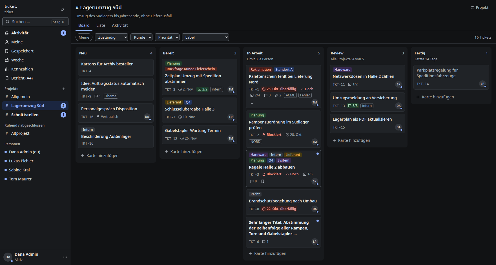
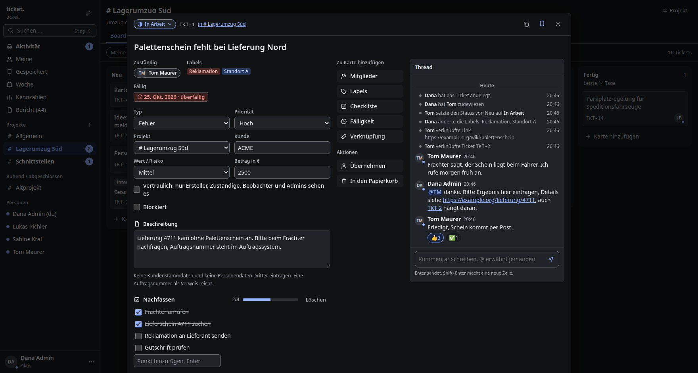
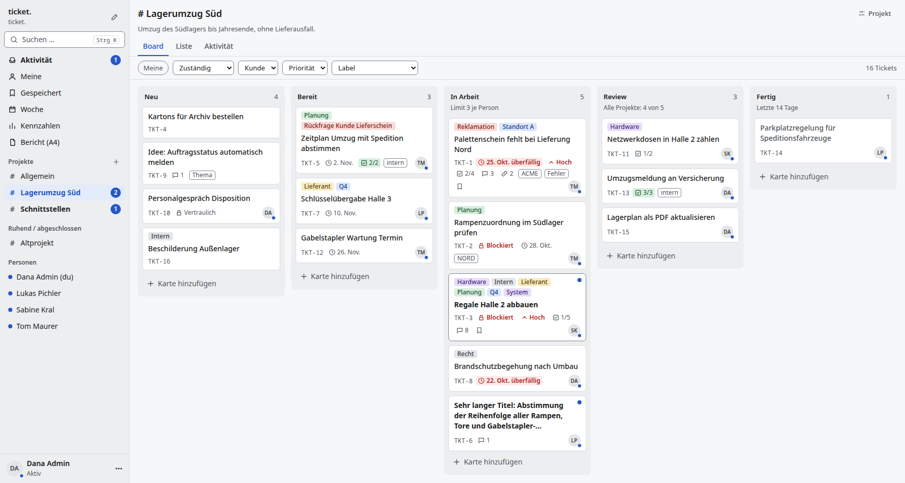
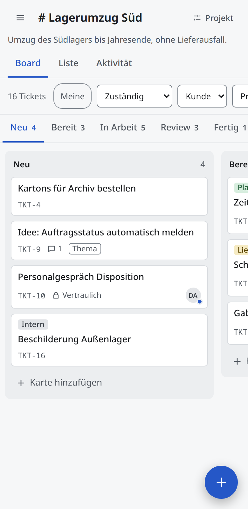

# ticket.

Ticket-Board für Teams zum Selbsthosten (self-hosted team ticket board: Slack-style sidebar and threads, Trello-style board; German UI, zero dependencies, MIT). Python-stdlib + SQLite, eine statische Oberfläche in `web/index.html`
(kein Framework, keine CDN-Abhängigkeit, kein Netz nach außen, kein Mailversand). Ticketnummern `TKT-n`.

| Karte mit Thread | Board hell | Handy |
|---|---|---|
|  |  |  |

Die Bilder zeigen erfundene Demodaten.

- `server.py` Server, 127.0.0.1:8909 (`TICKET_PORT`), systemd `ticket` als User `ticket`
- `web/index.html` die ganze Oberfläche (Slack-Schale: Seitenleiste, Projekte als Kanäle, Thread; Trello-Board: Listen, Karten, Kartenrückseite)
- `tests/` Tests mit `unittest` gegen temporäre Datenbanken: `python3 -m unittest discover -s tests`
- Daten `/var/lib/ticket/ticket.db` (`TICKET_DB`); Sicherung: die Datei oder `sqlite3 ticket.db ".backup ziel.db"` regelmäßig wegkopieren
- Zeitzone `TICKET_TZ` (Standard `Europe/Vienna`)

## Arbeitsweise

Zwei Ebenen: **Projekt** (läuft als Kanal in der Seitenleiste, "Allgemein" für lose Themen) und **Ticket**. Unteraufgaben sind Checklisten
am Ticket. Status: `neu` → `bereit` → `arbeit` → `review` → `fertig`, daneben `verworfen` und das Flag **blockiert** (mit Grund).
Das Board zeigt fünf Listen; `fertig` nur die letzten 14 Tage, danach liegt es im Archiv (Reiter Liste, "Archiv einblenden"). Keine Sprints.

- **WIP-Hinweis:** mehr als 3 Tickets in `arbeit` je Person oder mehr als 5 im `review` fragt nach einer Begründung ("Warum trotzdem?"),
  sperrt aber nicht. Limits stehen in den Einstellungen. `verworfen` und Wiedereröffnen aus `fertig` brauchen ebenfalls einen Satz.
  Die Begründung wird als Kommentar am Ticket gespeichert.
- **Reihenfolge** in der Liste steht im Feld `ticket.pos` und wird beim Ziehen gespeichert.
- **Vertraulich:** nur Ersteller, Zuständige, Beobachter und Admins sehen das Ticket (Board, Suche, Export, Aktivität, Bericht). Alle anderen
  sehen nur eine Zahl "vertrauliche Tickets".
- **Verlauf** ist append-only (Trigger in der Datenbank verbieten UPDATE/DELETE). Löschen ist ein Soft-Delete (nur Admin, Papierkorb unter
  Verwaltung). Kommentare lassen sich bearbeiten/löschen (nur eigene, Admin darf fremde löschen); der alte Wortlaut bleibt im Verlauf (nur Admins
  sehen ihn).
- Keine Kundenstammdaten oder Personendaten Dritter ins Ticket. Kunde ist nur ein Kürzel (wächst durch Nutzung; Vorschläge vorab über `TICKET_KUNDEN="ACME,BETA,intern"`).
- **Präsenz** (aktiv / abwesend / nicht stören) kommt aus dem letzten Abruf der Oberfläche (alle 20 s). Der Zeitpunkt wird nicht ausgeliefert, nur
  der Zustand. Das ist ein Mitarbeiterdatum: vor dem Einsatz mit Betriebsrat/Datenschutz klären; abschaltbar unter Verwaltung → Einstellungen.

## Erster Start und Konten

Eigene Konten, kein nginx-Login. Passwörter mit scrypt, Session-Cookie (HttpOnly, SameSite=Lax, 90 Tage gleitend, `Secure` hinter HTTPS),
CSRF-Token für alle schreibenden Requests.

1. Ist noch kein Admin da, gibt der Server beim Start einen **Setup-Code** im Log aus (`journalctl -u ticket`; oder fest über `TICKET_SETUP_CODE`).
2. Die Oberfläche zeigt dann die Einrichtung: Code, Name, Kürzel, Passwort. Ein Kürzel aus dem alten Board wird übernommen und wird Admin.
3. Weitere Personen: Verwaltung → Personen → **Einladungslink erzeugen** (einmal benutzbar, 7 Tage). Wer ihn öffnet, setzt Namen, Kürzel und Passwort.
   Für Kürzel aus dem alten Board gibt es "Einladungslink" (Name und Kürzel stehen schon) und später "Zugang zurücksetzen".
4. Rollen: `mitglied` und `admin`. Admins verwalten Personen, Einstellungen, Papierkorb, Projekte schließen, Labels löschen.

## Migration vom alten Schema

Beim Start erkennt `server.py` das alte Schema (Tabelle `leute`) und migriert in **einer Transaktion**. Vorher entsteht ein Backup der Datei
neben der Datenbank: `ticket.db.vor-neu-JJJJMMTT`. Bricht die Migration ab, bleibt die DB unverändert und der Server startet nicht.
Zurück auf den alten Stand: Dienst stoppen, Backup über `ticket.db` kopieren, alten `server.py` einspielen.

- `leute` → `nutzer` (Kürzel bleibt Schlüssel, alle Mitglieder, ohne Passwort), alles in Projekt "Allgemein", Typ `aufgabe`
- Status `backlog` → `bereit`; `arbeit`/`review`/`fertig` unverändert; dazu je ein Verlaufseintrag "Backlog → Bereit"
- `begonnen`, `fertig_am`, `ersteller` aus dem Verlauf zurückgerechnet (sonst Ersatz aus `angelegt`/`geaendert`)
- `teilaufgabe` → Checkliste "Checkliste" + `unteraufgabe`; Kommentare, Verlauf, Nummern, `pos`, Papierkorb und Sprintarchiv
  (`archiv_sprint`, Tabelle `sprint`) bleiben. Alte Links `TKT-n` gelten weiter.
- Nach der Migration hat niemand ein Passwort: Setup (siehe oben), dann Einladungslinks.

## Webhook für Commits

Verwaltung → Einstellungen → "Webhook für Commits" erzeugt eine URL `https://…/api/hook/<token>`. In Forgejo/Gitea/GitHub als Webhook
eintragen (Ereignis Push, Content-Type `application/json`). Steht `TKT-12` in einer Commit-Nachricht, wird der Commit am Ticket verknüpft
(einmalig, doppelte Zustellung schadet nicht). Der Token ist das Geheimnis: nur über HTTPS verwenden, bei Verdacht neu erzeugen.
Von Hand geht es immer: im Ticket "Verknüpfung" (Hash, URL, Dateipfad oder TKT-Nummer).

## Bericht und Export

- `/bericht` A4-Statusbericht (druckfertig, Strg+P), angemeldet. Kennzahlen, Was hängt, Fälligkeiten, je Kunde. Zeigt immer den aktuellen Stand.
- Berichtslink ohne Login: Verwaltung → Einstellungen → "Berichtslink" (`/bericht/<token>`, nur lesen, vertrauliche Tickets nur als Zahl).
- CSV aller sichtbaren Tickets: Nutzermenü → "Tickets als CSV" (`;`-getrennt, UTF-8 mit BOM, für Excel).

## Deploy

Beispiel mit systemd und nginx (Pfade und Domain anpassen):

    install -d /opt/ticket/web /var/lib/ticket
    cp server.py /opt/ticket/ && cp web/index.html /opt/ticket/web/
    cp ticket.service /etc/systemd/system/ && systemctl daemon-reload && systemctl enable --now ticket
    # nginx-ticket.conf als Site einbinden, Domain und Zertifikatspfade anpassen

Die App hat eigene Konten, deshalb gehört kein Basic Auth davor: Bericht- und Webhook-Links müssen ohne nginx-Login erreichbar sein.
`nginx-ticket.conf` setzt `X-Forwarded-Proto` (für das `Secure`-Cookie) und `client_max_body_size 1m` (Push-Webhooks).

**Hinter einem Proxy `TICKET_TRUST_PROXY=1` setzen** (steht in `ticket.service`; bei bestehender Installation die Unit nachziehen,
`systemctl daemon-reload`). Nur dann gilt `X-Real-IP` als Adresse des Clients
(Login-Drossel, Setup, Webhook, Einladungen). Ohne die Variable zählt die Adresse der Verbindung, und ein vom Client gesetzter
Header kann die Drossel nicht umgehen. Setzen darf man sie nur, wenn der Proxy den Header selbst setzt und nicht einfach durchreicht
(nginx: `proxy_set_header X-Real-IP $remote_addr;`, wie in der Vorlage). Fehlt sie hinter einem Proxy, teilen sich alle Personen
einen Drossel-Topf (8 Fehlversuche je Kürzel, 40 insgesamt in 10 Minuten).

## Lokal starten und testen

    TICKET_DB=/tmp/ticket.db python3 server.py     # http://127.0.0.1:8909
    python3 -m unittest discover -s tests          # ca. 1 Minute, kein Netz nötig

## Lizenz

MIT, siehe `LICENSE`.
